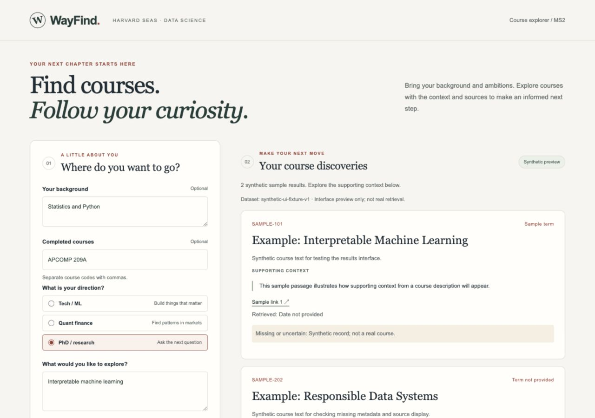
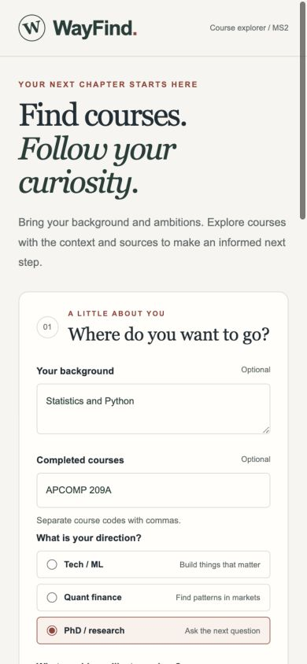

# Frontend verification - October 13, 2026

Scope: local MS2 frontend and proxy. Base: `6dab78dfe754a9d8cb91aa912a92a40b7c9c4b5f` on `main`.

## Observed checks

| Check | Result |
| --- | --- |
| `node --test frontend/tests/api.test.mjs` | 6 tests passed: profile mapping, source URL validation, response shape, successful/empty responses, HTTP/network/JSON failures, timeout. |
| `python3 -m unittest discover -s frontend/tests -v` | 5 tests passed: asset allowlist, request validation, forwarding and snapshot preservation against a stub, upstream failure handling. |
| `docker build -t wayfind-frontend:ms2 frontend` | Passed on local Docker Desktop. |
| `FRONTEND_PORT=8081 docker compose -p wayfind-ms2-frontend -f frontend/compose.yaml up --build -d --wait` | Passed; service reached healthy state. Port 8081 avoided the separate Python preview on 8080. |
| `GET http://127.0.0.1:8081/health` | HTTP 200, `{"status":"ok","component":"frontend"}`. |
| Container `POST /search` while no retrieval service runs | HTTP 503, `{"error":"Search service unavailable"}`. No mock fallback. |
| Browser synthetic success, empty, error and retry | Observed two labeled sample cards; no-match guidance; simulated error; successful retry with profile values retained. |
| Browser live mode while no retrieval service runs | HTTP 503 message displayed and submit button re-enabled. |
| Browser loading | Visible status and disabled submit button observed during synthetic delay. |
| Responsive layout | Checked at 1280px and 390px; document width equaled viewport width at each size. |

Python proxy tests needed permission to bind local ports; they passed after rerunning outside the filesystem/network sandbox. Docker Desktop was started before container verification.

## Screenshots

These are viewport captures of **synthetic UI preview**, not real course data or proof of end-to-end retrieval. The entered profile is a test example.

## Still pending

- Agreement with Shravya on the proposed API contract.
- Real dataset + embedding/index + retrieval service integration.
- Ming's five acceptance queries against actual courses and supporting context.
- Full team Compose pipeline, dataset provenance evidence, and clean-checkout verification by another member.
- Final screenshots and presentation from the integrated milestone2 commit.

The current checks establish frontend behavior and a stubbed proxy contract only. Keep issues #4 and #6 open until the live integration evidence exists.
